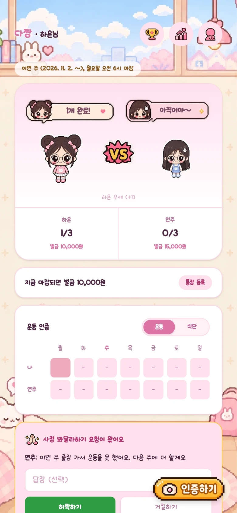
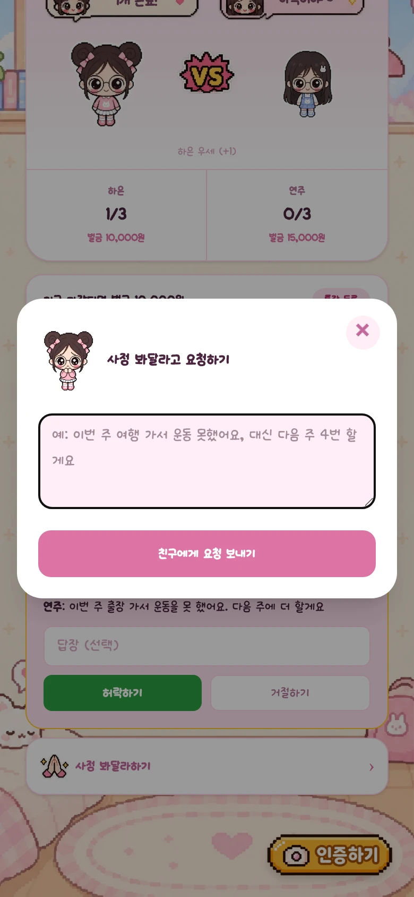
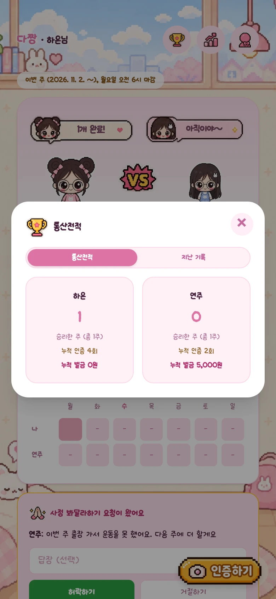

# 다짱

친구와 1:1로 운동·식단·몸무게 인증 대결을 하는 PWA. 방 코드로 친구를 초대하고, 주 3회 운동 인증을 못 하면 벌금을 낸다.

<p align="center">
  
  
  
  
</p>

## 주요 기능

- **방 코드 입장**: 6자리 코드로 참여. 방 하나가 1:1 한 판이며, 친구가 여럿이면 방을 여러 개 만든다
- **사진 한 장으로 인증**: AI가 운동 / 식단 / 체중계를 구분해 기록. 아이폰은 [동작 버튼 연동](docs/meal-shortcut.md) 지원
- **식단 칼로리 분석**: AI가 음식 이름과 칼로리를 계산하고, 달력 히트맵과 하루 평균 칼로리를 표시
- **몸무게 인증**: 주 1회 체중계 사진으로 인증. 숫자는 본인만 볼 수 있고 친구에게는 ▲▼만 표시
- **대결 카드**: 이번 주 인증 횟수를 캐릭터 배틀로 표시. 콕 찌르기, 이모티콘 반응 지원
- **사정 봐달라하기 / 쉬어가기 / 리본**: 상호 동의로 벌금을 면제하거나 쉬어간다
- **모임 통장, 통산전적, 웹 푸시 알림**

## 규칙

- 하루와 한 주는 오전 6시(KST)에 바뀌며, 마감 후에는 소급할 수 없다
- 운동: 주 3회, 하루 1장만 인정, 사진 촬영 시각(EXIF) 기준. 부족한 횟수 × 5,000원
- 몸무게·식단 벌금: 두 사람이 금액에 합의하면 다음 주부터 적용. 몸무게는 인증을 안 했거나 늘었을 때, 식단은 안 올린 날마다 부과
- 사정 봐달라하기: 월 1회, 상대가 허락하면 그 주 벌금 전액 면제
- 쉬어가기: 상대가 수락하면 둘 다 쉬고, 거절하면 요청한 사람만 쉼
- 리본: 친구가 쉬는 주에 목표를 채우면 받고, 벌금이 생긴 주에 자동으로 사용해 면제
- 인증 사진은 주가 끝나면 삭제되고, 횟수와 식단 기록은 유지

## 기술 스택

Next.js 16 · React 19 · TypeScript · Tailwind CSS v4 · Prisma + PostgreSQL(Neon) · web-push · Vercel(Cron 포함)

사진 분석은 AI API 게이트웨이(`gpt-6-luna`)를 사용한다.

## 로컬 개발

```bash
npm install
npx prisma migrate dev
npm run dev
```

`.env` 설정:

| 변수 | 설명 |
|---|---|
| `DATABASE_URL` | Postgres 연결 문자열 |
| `SESSION_SECRET`, `CRON_SECRET` | 랜덤 문자열 |
| `VAPID_PUBLIC_KEY`, `VAPID_PRIVATE_KEY`, `NEXT_PUBLIC_VAPID_PUBLIC_KEY` | `npx web-push generate-vapid-keys`로 생성 (`NEXT_PUBLIC_`은 public key와 동일) |
| `BAZE_API_KEY` | 사진 분석 AI 키 |
| `OWNER_CODE` | 관리자 화면 코드. 운영에서는 반드시 설정 |
| `EXTERNAL_TOKEN` | (선택) 외부 앱용 읽기 전용 API 토큰 |

`http://localhost:3000`에서 "방 만들기"로 시작한다.
